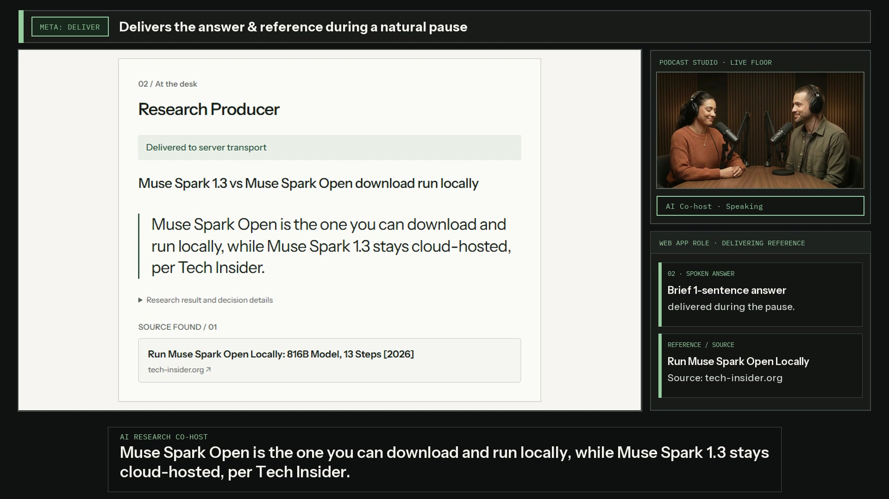

# Keep Talking

### Keep the conversation. Delegate the lookup.

**An AI research co-host for small podcast teams without a dedicated research producer.**

A forgotten reference should not stop a good conversation. Ask Keep Talking to check it, keep discussing, and get a short answer with a source when there is room to speak.

[](https://github.com/THEGREATCJPark/aipodcast-meta-hackathon/releases/download/keep-talking-v11/keep-talking-v11-antigravity-review.mp4)

**[Watch the 89-second demo →](https://github.com/THEGREATCJPark/aipodcast-meta-hackathon/releases/download/keep-talking-v11/keep-talking-v11-antigravity-review.mp4)** · [Download full-quality video and English captions](https://github.com/THEGREATCJPark/aipodcast-meta-hackathon/releases/tag/keep-talking-v11)

## A producer that knows when to speak

1. **Ask in context.** Refer to something already discussed instead of starting a separate search.
2. **Keep talking.** Research continues in the background while the hosts develop their argument.
3. **Get the answer, keep the floor.** The co-host checks the current discussion, waits for a pause, delivers a short sourced answer, and steps back.

The difference is **separating the moment research finishes from the moment the AI speaks**. Hosts can also hold or cancel output, and each session preserves speaker audio, transcripts and research references.

## In this demo

A host asks which Muse Spark model the team can run on its own hardware. The hosts keep discussing privacy and GPU memory while Keep Talking researches the question. It waits for a pause, gives a short answer with a source, and the hosts use that answer to discuss what to run locally and what to send to a hosted service.

The film combines scripted synthetic hosts with an actual Meta-backed app session, edited for time. [Demo evidence and production notes](docs/VIDEO_V11.md).

## Built with Meta

Meta transcribes the speakers, understands the contextual request, researches the reference and reviews whether the answer still belongs in the conversation. The app controls playback and interruption; a separate speech service voices the answer.

The hackathon contribution is this conversation-aware research and turn-taking flow, built on an existing voice studio. [What we built](HACKATHON.md) · [Code provenance](docs/PROVENANCE.md)

## Try it locally

Requires Node.js 22.22+ and npm.

```bash
npm ci
npm run build:web
npm run dev
```

Open **http://localhost:4400/?view=judge** for the conversation and research view. For a live session, configure the credentials described in [.env.example](.env.example) and enable **Research PD** in the studio.

[Reviewer setup](docs/JUDGE_GUIDE.md) · [Architecture](docs/ARCHITECTURE.md) · [Evaluation](docs/EVALUATION.md) · [Submission copy](docs/SUBMISSION.md)
